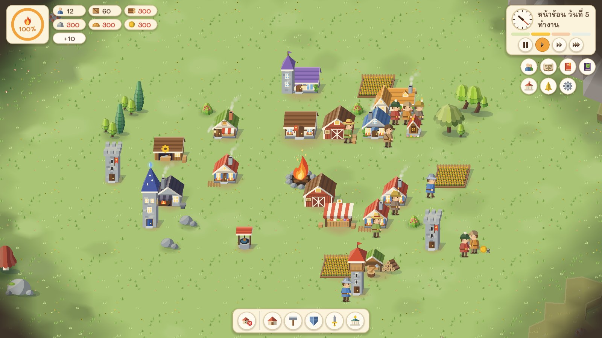
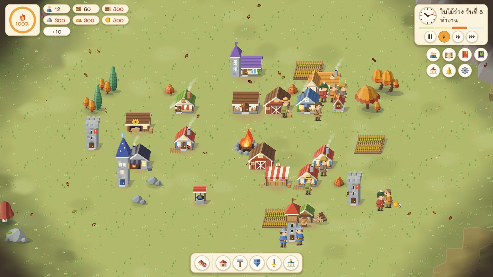
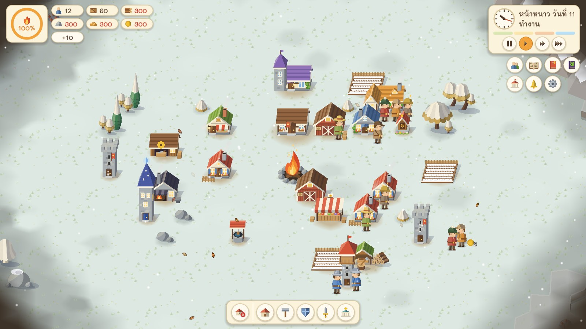
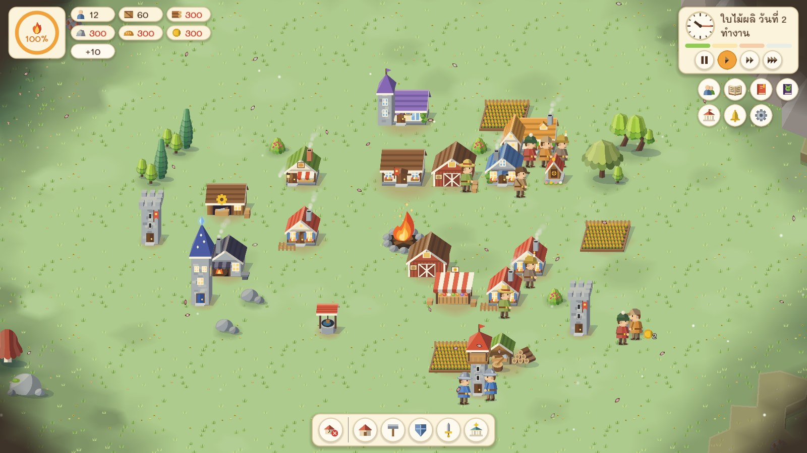
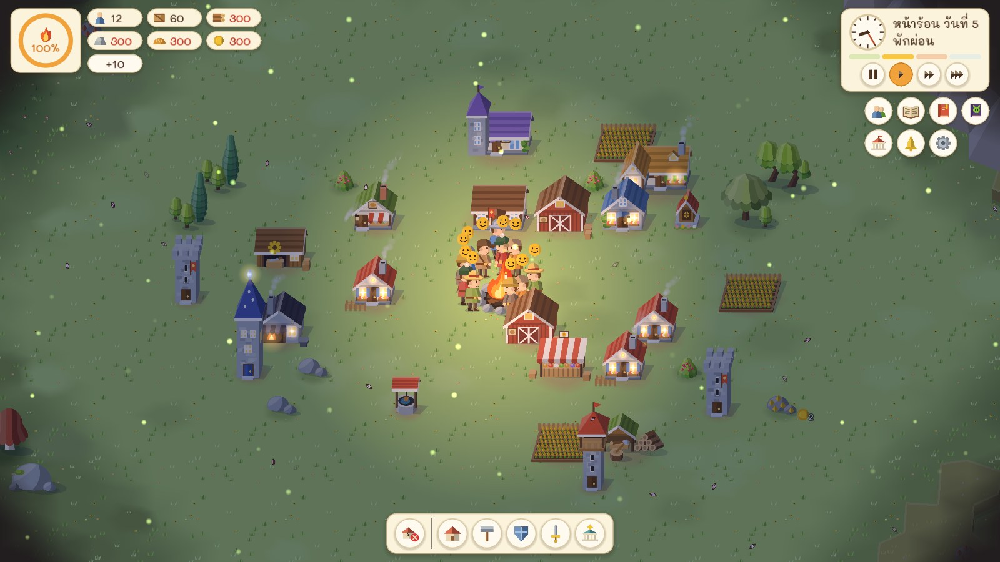
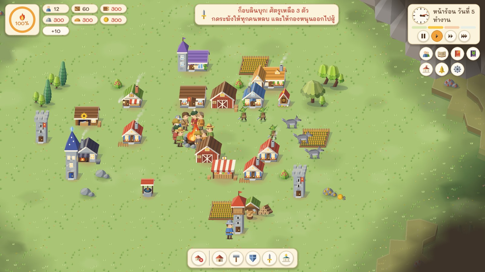

# Heartfire 🔥

เกมสร้างหมู่บ้านเล็กๆ รอบกองไฟ ดูแลชาวบ้านให้อิ่ม ให้อุ่น ให้มีความสุข ผ่านไปทีละฤดู แล้วคอยป้องกันหมู่บ้านตอนก็อบลินกับมอนสเตอร์บุกมา

## ⬇️ ดาวน์โหลด

**[ดาวน์โหลดเวอร์ชันล่าสุด](https://github.com/PongsakornNaklang/heartfire-releases/releases/latest)**

- **Windows:** โหลด `Heartfire-windows.zip` แตกไฟล์แล้วเปิด `Heartfire.exe`
- **Mac:** โหลด `Heartfire-mac.zip` แตกไฟล์แล้วคลิกขวาที่ Heartfire > Open

มีเวอร์ชันใหม่เมื่อไร เกมจะบอกเองตอนเปิด

## 🍂 สี่ฤดู

หมู่บ้านเปลี่ยนไปตามฤดู ใบไม้ร่วงหน้าใบไม้ร่วง หิมะตกหน้าหนาว ดอกไม้บานหน้าใบไม้ผลิ เช้าวันแรกของฤดูใหม่จะมีลมพัดกลีบดอก ใบไม้ หรือหิมะผ่านจอ

| | |
|---|---|
|  |  |
|  |  |

## 🏡 สร้างหมู่บ้าน

บ้าน ฟาร์ม ครัว โรงตีเหล็ก ห้องสมุด ตลาด ป้อมธนู มีให้สร้างกว่า 500 แบบ อัปเกรดได้ทุกหลัง ชาวบ้านมี 13 อาชีพ ทั้งชาวนา คนตัดไม้ ช่างก่อสร้าง ไปจนถึงทหารยาม แต่ละคนมีความหิว ความเหนื่อย และอารมณ์ของตัวเอง

ตกเย็นทุกคนจะมานั่งล้อมกองไฟ หน้าต่างบ้านเปิดไฟสว่าง แล้วก็แยกย้ายกันไปนอน

## ⚔️ ป้องกันหมู่บ้าน

มอนสเตอร์ 20 เผ่ามาบุกเป็นระยะ ทั้งก็อบลิน หมาป่า ไปจนถึงจอมมาร พอศัตรูมาก็ตีระฆังให้ชาวบ้านไปหลบ ทหารยามกับป้อมจะออกไปสู้ให้ ถ้ากองไฟดับ หมู่บ้านก็จบ

## 📖 เรื่องเล่าระหว่างทาง

แมวส้มหลงมา เด็กก็อบลินหิวข้าว แม่มดเปิดกระท่อม คาราวานพ่อค้าแวะมา ทุกเรื่องมีตัวเลือกให้ตัดสินใจ แล้วบางเรื่องก็ยังไม่จบแค่นั้น

---

เจออะไรแปลกๆ หรืออยากให้เพิ่มอะไร บอกได้เลย 🙏
